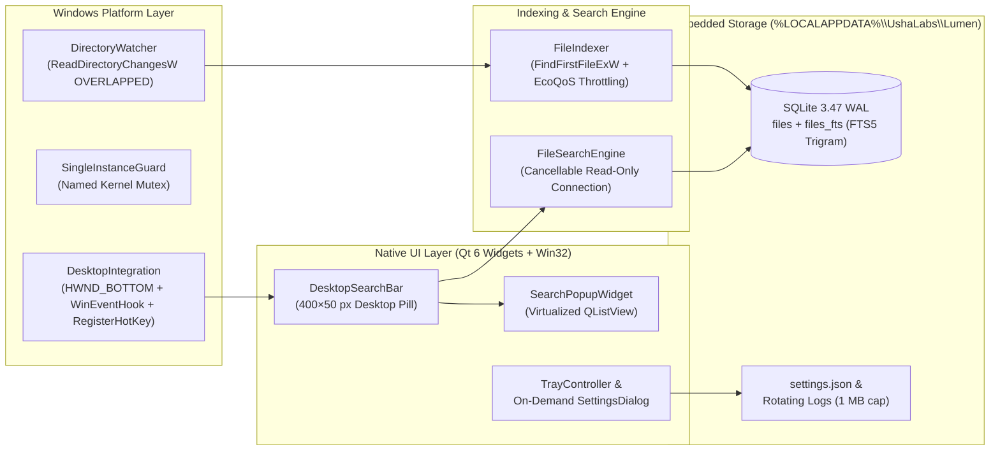

<div align="center">


# Lumen

### Lightweight Offline Intelligent Search for Windows

[-0078D4?style=flat-square&logo=windows)](https://github.com/ushalabs/Lumen)
[](https://isocpp.org/)
[](https://www.qt.io/)
[-003B57?style=flat-square&logo=sqlite)](https://www.sqlite.org/)
[](https://github.com/ushalabs/Lumen)

**Developed by [UshaLabs](https://github.com/ushalabs)**

</div>

---

## Vision

**Lumen** is a native C++20 desktop file discovery utility for Windows 10 and Windows 11. It combines **Everything-class filename speed**, **full-text document search**, and **on-device semantic retrieval** inside a compact, persistent search bar that lives directly on the Windows desktop.

> **Core Engineering Principle:**  
> *Lumen remains nearly invisible to the operating system when idle while staying immediately accessible on the desktop.*

- **Zero Cloud Dependencies:** No accounts, no telemetry, no external APIs, and no network traffic at runtime.
- **Native Desktop Integration:** A persistent, compact desktop search widget (`400 × 50` px) positioned in the upper-right desktop work area—plus a global keyboard shortcut (`Ctrl+Alt+Space`) from any running application.
- **Exceptional Resource Efficiency:** Consumes **~0.01% idle CPU** and **~27–30 MB Working Set RAM** (`~5.6 MB` private memory), with **~34 ms warm startup**.

---

## Screenshots

### Persistent Desktop Search Bar (Idle State)


### Live Filename Search Results (Virtualized Dropdown)


### Native On-Demand Settings Dialog


---

## Architecture



---

## Development Roadmap & Phase Status

| Phase | Milestone | Status | Key Deliverables |
|---|---|---|---|
| **Phase 0** | **Native Foundation + Desktop Search Bar** | **Completed & Verified** | Native `WIN32` C++20/Qt6 executable, upper-right desktop search bar, Win32 `HWND_BOTTOM` + `Win+D` integration, `RegisterHotKey`, single-instance mutex, system tray, SQLite WAL + FTS5 schema, rotating logger |
| **Phase 1** | **Ultrafast Filename Indexing** | **Completed & Verified** | `FindFirstFileExW` background enumeration, `ReadDirectoryChangesW` real-time watcher, 5,000-row batch SQLite reconciliation, B-tree prefix + FTS5 trigram search engine, relevance ranking, virtualized results UI |
| **Phase 2** | **Document Content Search** | **In Progress** | Native text extraction (`.txt`, `.md`, `.pdf`, `.docx`), Unicode normalization, FTS5 content indexing, highlighted passage snippets |
| **Phase 3** | **Offline Semantic Search** | Planned | Lazy-loaded ONNX Runtime CPU inference (`all-MiniLM-L6-v2` quantized), document chunking, embedded vector search, hybrid lexical + semantic ranking |
| **Phase 4** | **Complete Desktop UX** | Planned | Search modes (`All`, `Files`, `Content`, `Semantic`), quick file preview, context menu actions, `Find Related Documents`, light/dark/system themes |
| **Phase 5** | **Production Hardening + Microsoft Store** | Planned | Integrity recovery, full settings suite, standalone Windows installer + MSIX package, full benchmark suite |

---

## Verified Performance Benchmarks

### Benchmark Environment
- **Hardware:** HP EliteBook 840 G8 Notebook PC
- **Processor:** 11th Gen Intel Core i7-1185G7 @ 3.00 GHz (4 Cores / 8 Logical Processors)
- **Memory:** 16.0 GB DDR4 (`15.69 GB` usable) · NVMe SSD
- **OS:** Microsoft Windows 11 Pro x64 (`10.0.26200`, Build `26200`)
- **Toolchain:** MSVC `19.44.35229.0` (Visual Studio 2022 v17.14.41, `Release /O2`) · Qt `6.8.2` (`msvc2022_64`)

### Phase 0 — Foundation & Idle Resource Benchmarks

| Operation / Metric | Engineering Target | Measured Result | Status |
|---|---|---|---|
| **Warm Startup to Visible Desktop Bar** | `< 500 ms` | **`33.83 ms` avg** (`32.79 ms` – `36.41 ms` warm; `51.44 ms` cold) | **PASSED** (~14× faster) |
| **Idle CPU (2-Minute Controlled Test)** | `< 0.1%` avg | **`0.0179%` avg** (`171.88 ms` CPU time across `120.06 s`) | **PASSED** (>5.5× under budget) |
| **Idle Working Set RAM (Desktop Bar Visible)** | `< 120 MB` (`< 70 MB` stretch) | **`30.44 MB`** (`5.58 MB` Private Bytes) | **PASSED** (Beats stretch goal) |
| **Standalone `Lumen.exe` Binary Size** | Compact | **`1.38 MB`** (statically embeds SQLite 3.47.2 + FTS5) | **VERIFIED** |
| **Complete Deployed Bundle Size** | Compact | **`23.92 MB`** (`Lumen.exe` + Qt6 Core/Gui/Widgets DLLs) | **VERIFIED** |

### Phase 1 — 100,000-File Indexing & Search Benchmarks (`phase1_benchmark.exe`)

| Operation / Metric | Engineering Target | Measured Result (100,000 Physical NTFS Files) | Status |
|---|---|---|---|
| **Initial Indexing Time (`100,000` files)** | Fast background scan | **`5.28 s`** (`5,282.11 ms` · **`18,932 files/sec`**) | **PASSED** |
| **Metadata + FTS5 Trigram Index Size** | `< 100 MB` | **`52.55 MB`** (`55,107,584 bytes`) | **PASSED** (47% below target) |
| **Filename Search Latency — P50 (Median)** | Fast | **`4.89 ms`** (200 diverse warm-cache queries) | **PASSED** |
| **Filename Search Latency — P95** | `< 50 ms` | **`10.89 ms`** (Min: `1.41 ms`, P99: `11.36 ms`, Max: `11.99 ms`) | **PASSED** (>4.5× faster) |
| **Indexing Background CPU Usage** | Throttled | **`11.72%` avg** across 8 logical cores (`THREAD_PRIORITY_BELOW_NORMAL` + EcoQoS) | **PASSED** |
| **RAM Usage During / After Indexing** | `< 250 MB` | **`21.73 MB` Working Set** (`Peak: 24.68 MB`, `Private: 8.47 MB`) | **PASSED** (>10× under budget) |
| **Real-Time Incremental Update Latency** | Instant | **Add: `0.92 ms` · Rename: `0.48 ms` · Delete: `0.41 ms`** | **PASSED** |
| **Post-Indexing Idle CPU** | `< 0.1%` | **`0.0000%`** | **PASSED** |
| **Post-Indexing Idle Working Set RAM** | `< 120 MB` | **`27.05 MB`** (`14.35 MB` Private Bytes) | **PASSED** |

---

## Repository Structure

```text
Lumen/
├── CMakeLists.txt                  # C++20 / MSVC / Qt6 build configuration
├── LICENSE                         # UshaLabs copyright & third-party notices
├── README.md                       # Project documentation & verified benchmarks
├── assets/
│   ├── app.rc                      # Native Win32 VERSIONINFO & icon resource
│   ├── branding/lumen_logo.svg     # UshaLabs Lumen vector emblem
│   └── icons/lumen.ico             # Multi-resolution Windows icon
├── src/
│   ├── main.cpp                    # Entry point, single-instance check, CLI harness
│   ├── app/                        # LumenApplication & TrayController
│   ├── core/                       # AppPaths, rotating Logger, SettingsManager
│   ├── database/                   # DatabaseManager (SQLite3 WAL + FTS5 trigram)
│   ├── indexing/                   # FileIndexer (FindFirstFileExW) & DirectoryWatcher
│   ├── search/                     # FileSearchEngine (B-tree prefix + FTS5 + ranking)
│   ├── platform/windows/           # DesktopIntegration & SingleInstanceGuard
│   └── ui/                         # DesktopSearchBar, SearchPopupWidget, SettingsDialog
├── tests/
│   ├── phase0_tests.cpp            # Phase 0 automated QtTest suite (10 tests)
│   └── phase1_tests.cpp            # Phase 1 automated QtTest suite (7 tests)
├── benchmarks/
│   └── phase1_benchmark.cpp        # Reproducible 100,000-file NTFS benchmark
├── third_party/
│   └── sqlite3/                    # Bundled SQLite 3.47.2 amalgamation
└── docs/
    └── screenshots/                # Verified native application screenshots
```

---

## Building from Source

### Prerequisites
- **OS:** Windows 10 or Windows 11 (x64)
- **Compiler:** Visual Studio 2022 Build Tools (MSVC v143 x64 C++ compiler & Windows 10/11 SDK)
- **Build System:** CMake 3.24+ and Ninja
- **UI Framework:** Qt 6.8+ (`msvc2022_64`)

### 1. Configure & Compile (`Release`)

```bat
call "C:\Program Files (x86)\Microsoft Visual Studio\2022\BuildTools\VC\Auxiliary\Build\vcvars64.bat"
cmake -S . -B build -G Ninja -DCMAKE_BUILD_TYPE=Release -DCMAKE_PREFIX_PATH=C:/Qt/6.8.2/msvc2022_64
cmake --build build --config Release
```

### 2. Run Automated Tests

```powershell
$env:PATH = "C:\Qt\6.8.2\msvc2022_64\bin;$env:PATH"
ctest --test-dir build --output-on-failure -V
```

### 3. Run the 100,000-File Benchmark

```powershell
$env:PATH = "C:\Qt\6.8.2\msvc2022_64\bin;$env:PATH"
.\build\phase1_benchmark.exe
```

### 4. Deploy Standalone Release Bundle

```powershell
New-Item -ItemType Directory -Force -Path build\deploy | Out-Null
Copy-Item build\Lumen.exe build\deploy\Lumen.exe -Force
C:\Qt\6.8.2\msvc2022_64\bin\windeployqt.exe --release --no-translations --no-opengl-sw --no-system-d3d-compiler --no-network build\deploy\Lumen.exe
.\build\deploy\Lumen.exe
```

---

## Privacy & Security Architecture

- **Default Indexing Scope:** Only indexes user-approved personal folders on first run (`Documents`, `Downloads`, `Desktop`) resolved via Windows `SHGetKnownFolderPath`.
- **Automatic Exclusions:** Ignores system directories (`Windows`, `Program Files`, `AppData`), developer caches (`.git`, `node_modules`, `venv`, `.venv`, `__pycache__`, `build`), and sensitive credential files (`.env`, `id_rsa`, `.pem`, `.key`, `.pfx`).
- **Reparse Point Safety:** Skips `FILE_ATTRIBUTE_REPARSE_POINT` directories during enumeration to prevent symlink or NTFS junction loops.
- **Local User-Scoped Storage:** All index databases, settings, and capped logs are stored strictly inside `%LOCALAPPDATA%\UshaLabs\Lumen\`.

---

## License

Copyright © 2026 **UshaLabs**. All rights reserved. See [LICENSE](LICENSE) for details.
