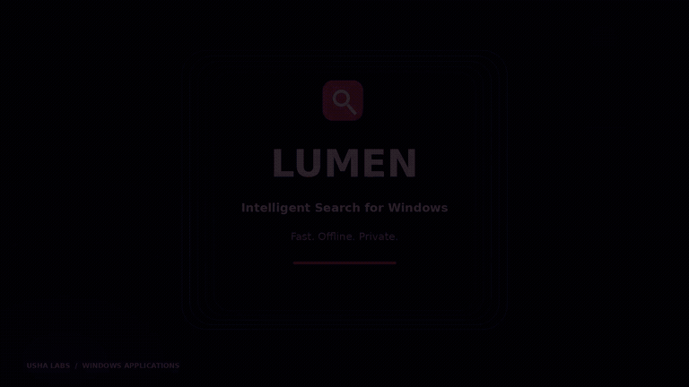

<h1 align="center">
  
  <br />
  Lumen
</h1>

<p align="center">
  <strong>Lightweight Offline Intelligent Search for Windows</strong>
</p>

<p align="center">
  <a href="https://github.com/ushalabs/Lumen"></a>
  <a href="https://isocpp.org/"></a>
  <a href="https://www.qt.io/"></a>
  <a href="https://www.sqlite.org/"></a>
  <br />
  <a href="https://onnxruntime.ai/"></a>
  <a href="#installation-windows-10--11-x64"></a>
  <a href="https://github.com/ushalabs/Lumen"></a>
</p>

---

## About Lumen

**Lumen** is a native offline desktop search utility for Windows built to help you find files, folders, document contents, and meaning from one lightweight bar.

It supports:

- **Whole-PC file and folder search** across all local drives (while automatically skipping Windows system and cache junk)
- **Strict folder hierarchy** ranked cleanly from Desktop and drive roots down to deeper subfolders
- **Document content search** inside PDFs (with page numbers), Word documents, Excel/CSV spreadsheets, source code, plain text, and media metadata
- **Offline AI semantic search** using local `all-MiniLM-L6-v2` embeddings to match concepts and natural-language queries
- **Automatic real-time indexing** that detects newly added, renamed, and installed files in the background
- **Compact floating bar & inspector** with quick actions to open files, reveal them in Explorer, copy paths or files, find related documents, and pin favorites
- **System Tray background mode** that starts with Windows, stays off your taskbar, and opens anytime with **`Ctrl+Alt+Space`**

The goal of Lumen is to deliver fast, private Windows search that finds what you need right away without cloud APIs or taskbar clutter.

---

## Search Bar

<p align="center">
  
</p>

Open Lumen from the desktop launcher or press **`Ctrl+Alt+Space`** from anywhere. It opens as a compact search bar, shows results under **All**, **Files**, **Folders**, **Content**, and **Semantic** tabs as you type, and expands the details inspector only when you select an item.

---

## Demo

<p align="center">
  
</p>

The walkthrough covers instant desktop lookup, whole-PC app and folder search across drives, offline semantic search, PDF/Word and spreadsheet content previews, and configuring folders in Settings.

---

## Settings

<p align="center">
  
</p>

### General
- **Show Lumen icon on the Windows desktop:** Shows or hides the floating desktop launcher while Lumen keeps running in the System Tray.
- **Keep desktop icon above active windows:** Pins the launcher above open windows instead of resting behind them on the desktop layer.
- **Launch Lumen automatically when Windows starts:** Starts Lumen automatically in the System Tray when you sign in to Windows.
- **Global activation shortcut:** Customizes the system-wide hotkey (default **`Ctrl+Alt+Space`**) used to summon and focus the search bar.
- **Desktop icon position (`Reset to Default Position`):** Moves the launcher back to its default screen position if dragged elsewhere.

### Search & Indexing
- **Index files & folders across all PC drives (skips OS & cache junk):** Enables whole-PC filename and folder search across all local drives while skipping system directories (`Windows`, `Program Files`, `AppData`) and build/cache folders (`.git`, `node_modules`, `build`, `Temp`, etc.).
- **Index text, code, spreadsheets & media metadata in selected folders:** Extracts searchable text and metadata inside supported documents only within your selected **Content & Semantic AI folders**.
- **Enable offline semantic search (`MiniLM-L6-v2`) in selected folders:** Generates local 384-D AI vector embeddings for natural-language semantic search within those same selected folders.
- **Content & Semantic AI folders (`Add Folder...` / `Remove` / `Rebuild Index`):** Choose which personal folders (defaulting to Windows `Documents`, `Downloads`, `Desktop`, `Pictures`, `Videos`, and `Music`) receive deep content and AI indexing. Clicking **Save Changes** automatically indexes newly added folders; **Rebuild Index** clears and rebuilds `lumen.db` from scratch when troubleshooting.

### Storage & Privacy
- Shows live database counts (**indexed items**, **content docs**, and **semantic docs**) along with the local path to `lumen.db`.

---

## Technology

| Component | Technology |
| --- | --- |
| Language & Runtime | C++20 (`MSVC v143`), Win32 APIs |
| Desktop UI | Qt 6 Widgets (`6.8.2`) |
| Storage & Full-Text Search | SQLite 3 (WAL mode + FTS5 trigram / BM25) |
| Local Semantic AI | ONNX Runtime CPU + `all-MiniLM-L6-v2` (INT8, lazy-loaded) |
| Document Extraction | PDFium (`.pdf`) + built-in `.docx`, `.xlsx`/`.xlsm`/`.csv`, code & metadata parsers |
| Build & Packaging | CMake, Ninja, NSIS (`x64`) |

---

## Installation (Windows 10 / 11 x64)

### Option 1: Standalone Setup Installer
1. Build or download **`Lumen-v0.5.1-Setup-x64.exe`** from `dist\` (or [GitHub Releases](https://github.com/ushalabs/Lumen/releases)).
2. Run the per-user installer (installs into `%LOCALAPPDATA%\Programs\Lumen` with no Administrator prompt required).
3. Includes Qt 6, MSVC runtime DLLs, PDFium, ONNX Runtime CPU, and `all-MiniLM-L6-v2` out of the box.

### Option 2: Build from Source
**Requirements:** Windows 10/11 (`x64`), Visual Studio 2022 (`MSVC v143`), CMake 3.24+, Ninja, Qt 6.8+ (`msvc2022_64`), and NSIS 3.x (optional for packaging).

```bat
call "C:\Program Files (x86)\Microsoft Visual Studio\2022\BuildTools\VC\Auxiliary\Build\vcvars64.bat"
cmake -S . -B build -G Ninja -DCMAKE_BUILD_TYPE=Release -DCMAKE_PREFIX_PATH=C:/Qt/6.8.2/msvc2022_64
cmake --build build --config Release --target Lumen
```

To build the NSIS installer and portable ZIP into `dist\`:

```powershell
powershell -ExecutionPolicy Bypass -File packaging\build_setup.ps1 -Version "0.5.1"
```

---

## Privacy & Local Storage

- **100% Offline:** Zero cloud APIs, accounts, or outbound network requests.
- **Built-in Exclusions:** Skips Windows system folders, developer caches, reparse points/symlinks, and sensitive credential files (`.env`, `.pem`, `.key`, `.pfx`, `id_rsa`).
- **Local App Data:** The SQLite database (`lumen.db`), `settings.json`, and rotating logs live strictly under `%LOCALAPPDATA%\UshaLabs\Lumen\`.

---

## Repository Structure

```text
Lumen/
├── assets/         # App icons, branding SVG, manifest, and quantized MiniLM model
├── benchmarks/     # Phase 1–3 indexing and latency benchmarks
├── docs/           # Screenshots and demo media for documentation
├── packaging/      # Windows NSIS installer and release packaging scripts
├── src/            # Native C++20 source (core, db, indexing, extraction, semantic, UI)
├── third_party/    # Embedded SQLite 3, ONNX Runtime, and PDFium headers/binaries
├── tools/          # Developer-only screenshot & startup measurement tool
├── CMakeLists.txt
├── LICENSE
└── README.md
```

---

## License

Copyright © 2026 **[UshaLabs](https://github.com/ushalabs)**. All rights reserved.  
See [LICENSE](LICENSE) for full terms and third-party notices.
