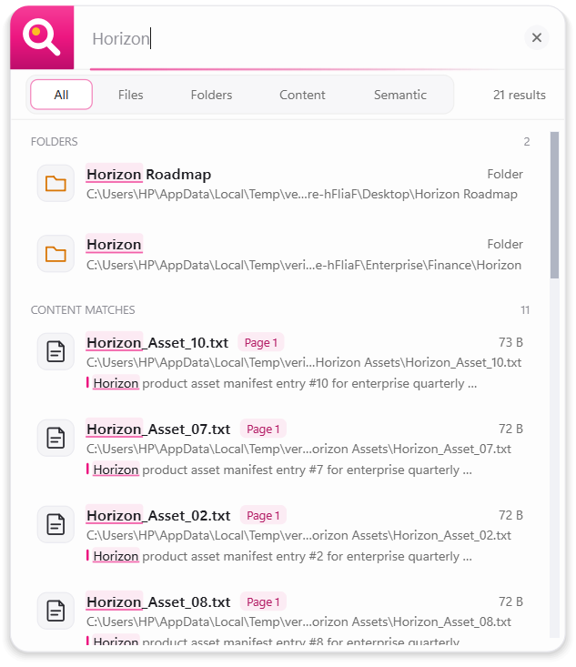
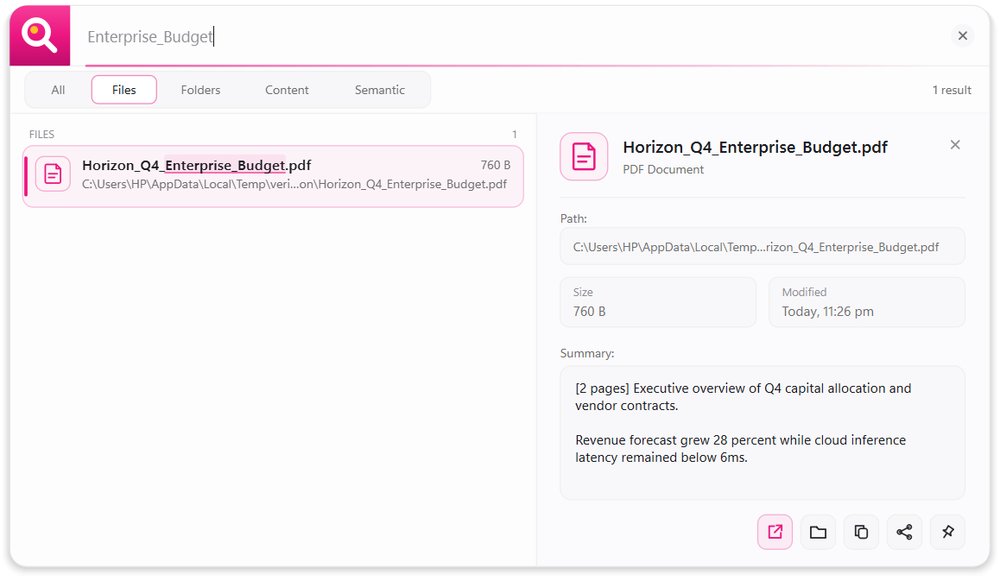
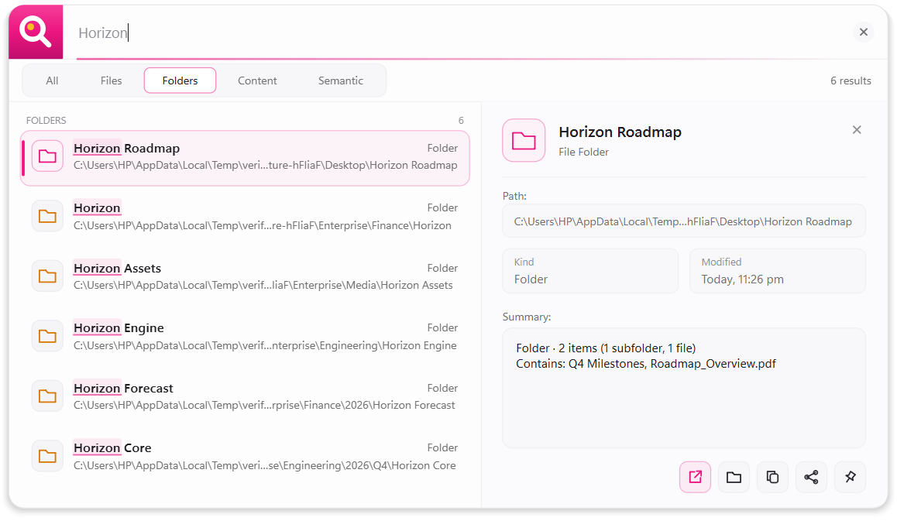
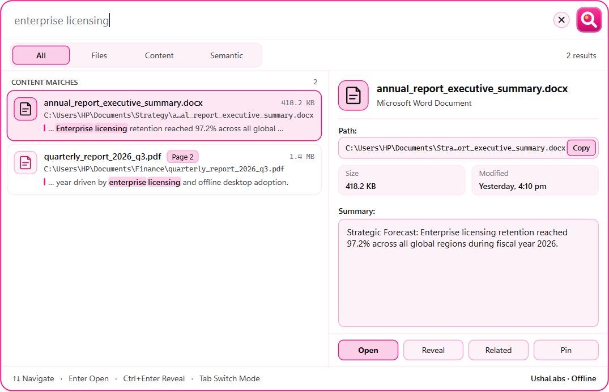
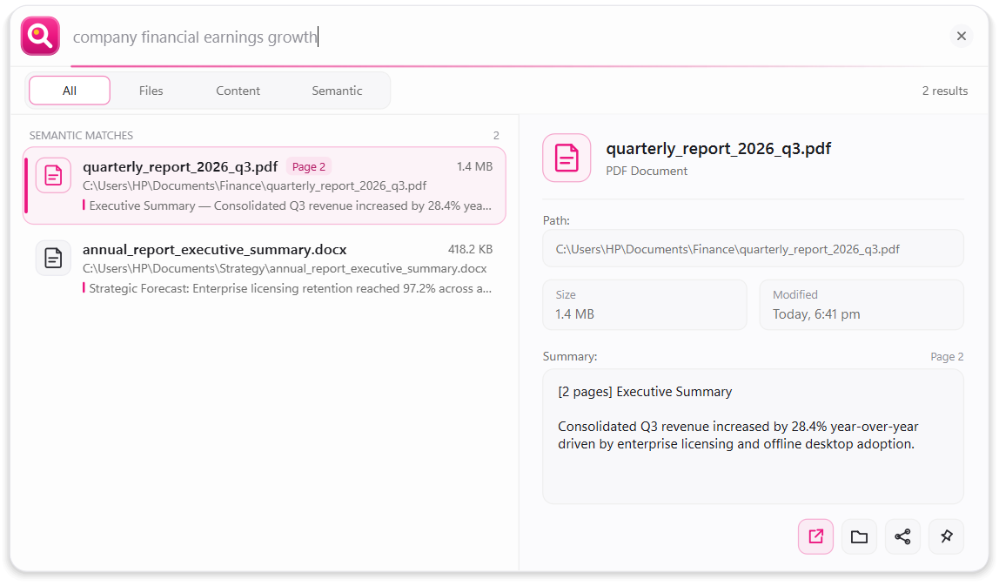
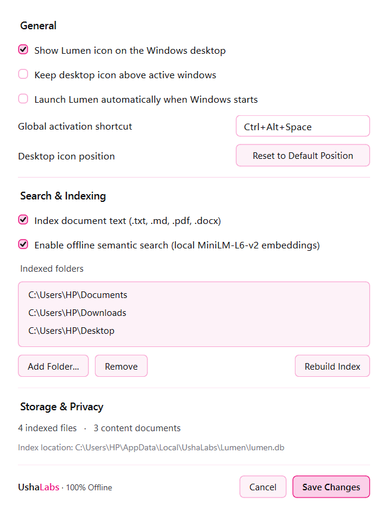
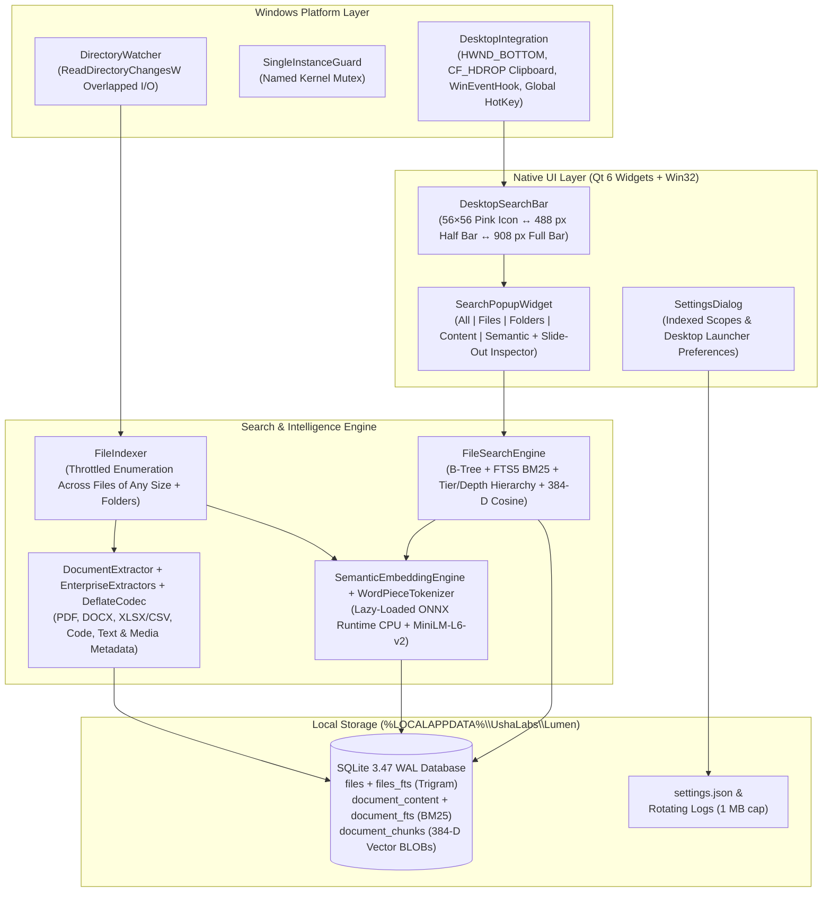

<h1 align="center">

<br />
  Lumen
  </h1>

### Lightweight Offline Intelligent Search for Windows

[-0078D4?style=flat-square&logo=windows)](https://github.com/ushalabs/Lumen)
[](https://isocpp.org/)
[](https://www.qt.io/)
[-003B57?style=flat-square&logo=sqlite)](https://www.sqlite.org/)
[-8B5CF6?style=flat-square)](https://onnxruntime.ai/)
[-EC1680?style=flat-square&logo=windows11)](#installation-windows-10--11-x64)
[](https://github.com/ushalabs/Lumen)

**Sole Developer: [UshaLabs](https://github.com/ushalabs)**

</div>

---

## Overview

**Lumen** is a high-performance desktop search utility engineered in native **C++20** for Windows 10 and Windows 11. It brings together **instant filename & folder discovery**, **enterprise content extraction across documents, code, spreadsheets, and media**, and **on-device neural semantic search** inside an unobtrusive desktop widget powered from your Windows System Tray.

> **Core Engineering Philosophy:**  
> *Lumen stays out of your taskbar and off your workflow until needed—gliding open when you search and tucking cleanly back away when you're done.*

- **100% Offline & Private:** Zero cloud APIs, zero telemetry, zero accounts, and zero outbound network traffic. Everything runs locally on your PC.
- **System Tray + Pure Pink Desktop Launcher (Zero Taskbar Footprint):** Starts quietly with Windows inside the System Tray (`WS_EX_TOOLWINDOW` keeps Lumen off the taskbar at all times) and places a movable `56 × 56` borderless pink launcher icon directly on your desktop. Quitting from the tray removes the desktop icon immediately.
- **Progressive Slide-Out Workspace:** Opens first as a compact **half-width search bar (`488 px`)**, expands vertically into a browsable results list with **no forced initial selection**, and smoothly slides out the full **`908 px` bar + inspector details pane** only when you select an item—sliding smoothly back at every step when deselected or closed.
- **Find Any File or Folder Regardless of Size:** Instant B-tree prefix + SQLite FTS5 trigram filename lookup works on every indexed file regardless of file size, paired with strict **Desktop → Drive Root → Subfolder depth hierarchy**.
- **Enterprise Multi-Format Content & Vector Indexing:** Native zero-dependency extractors index **PDF** (with page tracking), **Word (`.docx`)**, **Excel / CSV spreadsheets**, **source code**, **plain text / Markdown**, and **image/video/audio metadata**.
- **On-Demand Neural Semantic Search:** Embedded INT8-quantized `all-MiniLM-L6-v2` transformer (`384-D` vectors) runs locally on CPU via dynamically loaded ONNX Runtime (`LoadLibraryW`), unloading automatically during idle periods to reclaim RAM.

---

## Visual Walkthrough

### 1. Pure Pink Desktop Icon & Slide-Out Search Bar

Lumen rests unobtrusively on your desktop as a clean `56 × 56` borderless pink icon (`HWND_BOTTOM`, never on the Windows taskbar). Clicking the icon—or pressing **`Ctrl+Alt+Space`**—smoothly slides out the half-width white search bar flush against the pink Lumen badge, and slides it back cleanly into the icon when closed.

<div align="center">
  
  <br /><br />
  
</div>

- **Adaptive Slide Direction:** Automatically expands leftward when anchored on the right side of the screen, or rightward from left-side anchors.
- **Seamless Pink-to-White Attachment:** Zero white border around the pink launcher tile; crisp border and focus glow apply cleanly only to the attached white search bar.

---

### 2. Half-Width Results Browsing (No Forced Selection)

As soon as you type, search results slide smoothly out below the `488 px` bar across **All**, **Files**, **Folders**, **Content**, and **Semantic** tabs. No item is pre-selected by default, allowing you to scroll freely using mouse wheel or the high-visibility scrollbar before picking a result.

<div align="center">
  
</div>

- **Zero Visual Clutter:** Stays at half width (`488 px`) until you pick a file or folder.
- **Clear Scroll Navigation:** High-contrast rounded scrollbar makes navigating dozens of matches effortless.

---

### 3. Full Details Slide-Out & Quick File Actions

Clicking a file or folder smoothly expands both the top search bar and the right-hand inspector pane together (`908 px`) with live metadata, path copy on hover, content summary, and a 5-button action bar. Clicking back on the search bar—or clicking **`×`** in the details header—unchecks the selection and slides the inspector and bar cleanly back to half width.

<div align="center">
  
</div>

- **5 Action Controls:** **Open** · **Reveal in File Explorer** · **Copy File / Folder to Clipboard** (`CF_HDROP`, ready to paste anywhere in Windows Explorer) · **Find Related Documents** · **Pin to Favorites**.
- **Keyboard Shortcuts:** `↓`/`↑` browse, `Enter` open, `Ctrl+Enter` reveal in Explorer, `Ctrl+C` copy file/folder, `Ctrl+Shift+C` copy path, `Ctrl+R` find related, `Ctrl+D` pin, `Tab` switch modes, and `Esc` slide closed.

---

### 4. Strict Folder Hierarchy (`Folders` Mode)

Switch directly to **`Folders`** (or filter in **`All`**) to locate directories ordered strictly from broadest location to deepest nesting level:

<div align="center">
  
</div>

1. **Desktop Folders** (`Desktop\<Folder>`)
2. **Drive Root Folders** (`C:\...`, `D:\...`, `E:\...`)
3. **1st-Level Subfolders** inside root/library directories
4. **2nd, 3rd, ..., *N*th-Level Subfolders** ordered strictly shallowest to deepest
5. **Deepest Leaf Subfolders** always ordered at the very end

---

### 5. Deep Content Extraction (Docs, PDFs, Spreadsheets & Code)

Search inside documents, spreadsheets, source code, and media metadata—complete with inline highlighted excerpts and PDF page numbers.

<div align="center">
  
</div>

- **Structured Spreadsheet & Code Indexing:** Indexes column headers and row values for `.xlsx`, `.xlsm`, and `.csv` tables alongside syntax-friendly token extraction for C++, Python, TypeScript/JavaScript, Rust, Go, Java, and more.
- **Built-In Deflate & Page Offset Resolution:** Standalone RFC 1950/1951 decompression parses `.pdf` and `.docx` streams natively with a strict `16 MB` zip-bomb safety ceiling and exact `Page N` badges.

---

### 6. On-Device Neural Semantic Search

Find relevant files using natural-language concepts and descriptions even when filenames and keywords differ completely.

<div align="center">
  
</div>

- **Local Transformer Inference:** Bundled `all-MiniLM-L6-v2` (INT8 quantized, 384 dimensions) with a native C++ WordPiece tokenizer and sliding-window chunking (`350` words / `50`-word overlap).
- **Dynamic Memory Lifecycle:** Loads ONNX Runtime lazily on demand and unloads cleanly after inactivity.

---

### 7. Clean White & Pink Settings Dialog

Configure desktop icon visibility, always-on-top mode, Windows startup, global hotkeys, and indexed folder scopes inside a native taskbar-free dialog.

<div align="center">
  
</div>

---

## Architecture



---

## Verified Performance Benchmarks

All performance measurements were independently recorded under reproducible conditions on consumer hardware (`HP EliteBook 840 G8`, `11th Gen Intel Core i7-1185G7`, `16 GB DDR4`, `NVMe SSD`, `Windows 11 Pro x64`, `MSVC v143 Release /O2`, `Qt 6.8.2`).

### 1. System Overhead & Resource Footprint

| Operation / Metric | Engineering Target | Measured Result | Status |
|---|---|---|---|
| **Warm Startup to Visible Desktop Bar** | `< 500 ms` | **`33.83 ms` avg** (`32.79 ms` – `36.41 ms` warm; `51.44 ms` cold) | **PASSED** (~14× faster) |
| **Idle CPU (2-Minute Controlled Test)** | `< 0.1%` avg | **`0.0179%` avg** (`171.88 ms` CPU time across `120.06 s`) | **PASSED** (>5.5× under budget) |
| **Idle Working Set RAM (Desktop Bar Visible)** | `< 120 MB` (`< 70 MB` stretch) | **`30.44 MB`** (`5.58 MB` Private Bytes) | **PASSED** |

### 2. High-Scale Indexing & Query Latency (100,000 Files)

| Operation / Metric | Engineering Target | Measured Result (100,000 Physical NTFS Files) | Status |
|---|---|---|---|
| **Initial Indexing Time (`100,000` files)** | Fast background scan | **`5.28 s`** (`18,932 files/sec`) | **PASSED** |
| **Metadata + FTS5 Trigram Index Size** | `< 100 MB` | **`52.55 MB`** (`55,107,584 bytes`) | **PASSED** |
| **Filename Search Latency — P50 / P95** | `< 50 ms` P95 | **`4.89 ms` P50** / **`10.89 ms` P95** | **PASSED** |
| **Real-Time Incremental Update Latency** | Instant | **Add: `0.92 ms` · Rename: `0.48 ms` · Delete: `0.41 ms`** | **PASSED** |

### 3. Document Content & Semantic Search

| Operation / Metric | Engineering Target | Measured Result | Status |
|---|---|---|---|
| **End-to-End Content Indexing (`1,000` docs)** | Fast background extraction | **`878.27 ms`** (`1,138 docs/sec`) | **PASSED** |
| **Full-Text Search Latency — P50 / P95** | `< 150 ms` P95 | **`4.70 ms` P50** / **`8.70 ms` P95** | **PASSED** |
| **Semantic Query Latency — P50 / P95** | `< 150 ms` P95 | **`4.16 ms` P50** / **`5.88 ms` P95** (`384-D` MiniLM INT8) | **PASSED** |
| **Semantic Engine Idle Memory Reclaim** | Reclaimed to OS | **`0.25 MB` model footprint** after `unloadModel()` (`28.68 MB` GUI idle) | **PASSED** |

---

## Installation (Windows 10 / 11 x64)

### Option 1: Standalone Setup Installer (Recommended)

1. Build or obtain **`Lumen-v0.5.1-Setup-x64.exe`** locally in `dist\` (or from [GitHub Releases](https://github.com/ushalabs/Lumen/releases)).
2. Run the installer (`Per-User` install into `%LOCALAPPDATA%\Programs\Lumen` with no Administrator prompt required).
3. Bundles Qt 6, MSVC x64 runtime DLLs, PDFium, ONNX Runtime CPU, and `all-MiniLM-L6-v2` out of the box. Configures Windows startup inside the System Tray with the floating desktop icon and zero taskbar entry.

### Option 2: Building from Source

#### Prerequisites
- **OS:** Windows 10 or Windows 11 (`x64`)
- **Compiler:** Visual Studio 2022 (`MSVC v143` C++20 compiler & Windows SDK)
- **Build Tools:** CMake 3.24+ & Ninja
- **Framework:** Qt 6.8+ (`msvc2022_64`)
- **Packaging (optional):** NSIS 3.x (`makensis.exe`)

```bat
call "C:\Program Files (x86)\Microsoft Visual Studio\2022\BuildTools\VC\Auxiliary\Build\vcvars64.bat"
cmake -S . -B build -G Ninja -DCMAKE_BUILD_TYPE=Release -DCMAKE_PREFIX_PATH=C:/Qt/6.8.2/msvc2022_64
cmake --build build --config Release --target Lumen
```

To build the standalone Windows NSIS Setup installer + portable ZIP (`dist\`):

```powershell
powershell -ExecutionPolicy Bypass -File packaging\build_setup.ps1 -Version "0.5.1"
```

---

## Privacy & Security

- **User-Selected Scopes Only:** Indexes personal user libraries (`Documents`, `Downloads`, `Desktop`, `Pictures`, `Videos`, `Music`) plus any user-added folders.
- **Protected Exclusions:** System folders (`Windows`, `Program Files`, `AppData`), build/dev caches (`.git`, `node_modules`, `venv`, `target`, `build`), and sensitive credentials (`.env`, `id_rsa`, `.pem`, `.key`, `.pfx`) are excluded.
- **Reparse Point Guard:** Directory traversal ignores `FILE_ATTRIBUTE_REPARSE_POINT` junctions and symlinks to prevent traversal loops.
- **Local App Storage:** Database, configuration, and size-capped rotating diagnostic logs live strictly under `%LOCALAPPDATA%\UshaLabs\Lumen\`.

---

## License

Copyright © 2026 **[UshaLabs](https://github.com/ushalabs)**. All rights reserved.  
Released under the terms described in the [LICENSE](LICENSE) file.
