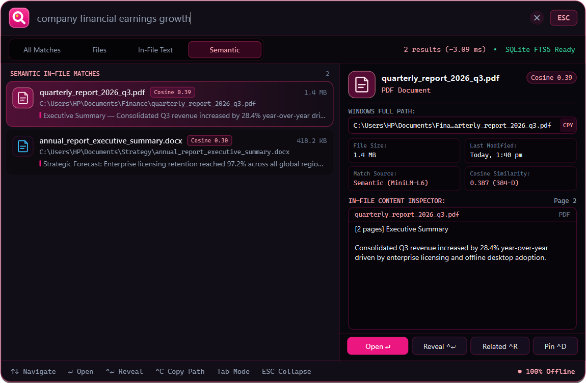
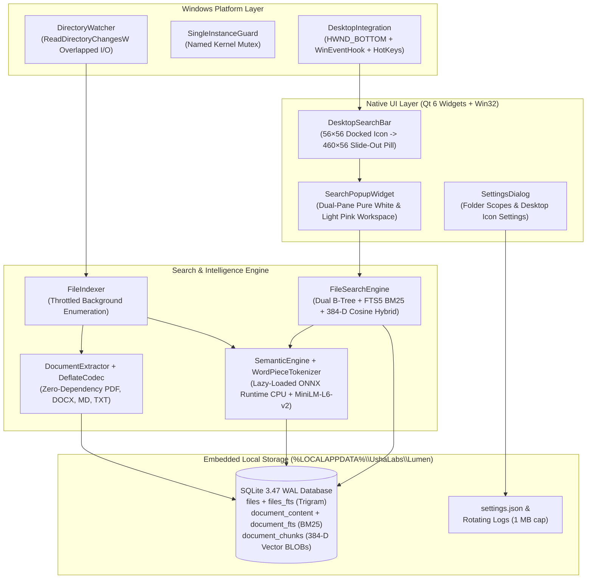

<div align="center">


# Lumen

### Lightweight Offline Intelligent Search for Windows

[-0078D4?style=flat-square&logo=windows)](https://github.com/ushalabs/Lumen)
[](https://isocpp.org/)
[](https://www.qt.io/)
[-003B57?style=flat-square&logo=sqlite)](https://www.sqlite.org/)
[-8B5CF6?style=flat-square)](https://onnxruntime.ai/)
[-0078D7?style=flat-square&logo=windows11)](https://github.com/ushalabs/Lumen)
[](https://github.com/ushalabs/Lumen)

**Developed with precision by [UshaLabs](https://github.com/ushalabs)**

</div>

---

## Overview

**Lumen** is a high-performance desktop search utility engineered in native **C++20** for Windows 10 and Windows 11. It brings together **instant filename discovery**, **deep document content indexing**, and **on-device neural semantic retrieval** inside an elegant, persistent search bar that lives directly on your Windows desktop.

Built to follow the visual identity and design language of **UshaLabs Downshift**, Lumen delivers a seamless desktop experience without the resource bloat of Electron or cloud dependencies.

> **Core Engineering Philosophy:**  
> *Lumen remains nearly invisible to the operating system when idle while staying instantly accessible on the desktop.*

- **100% Offline & Private:** No cloud APIs, no accounts, no telemetry, and zero network traffic. Everything is indexed, stored, and queried locally on your machine.
- **Always-Running System Tray & Embedded Desktop Icon:** Stays out of the Windows taskbar and runs continuously in the background from the system tray, with a movable `56 × 56` desktop launcher icon docked on the right by default. Clicking the icon smoothly slides out the search bar (`460 × 56` px) toward the center of the screen without popping open results until you type.
- **Instant Search Across 100k+ Files:** Sub-5ms query response times via dual-tier B-tree prefix indexing and SQLite FTS5 trigram matching.
- **Zero-Dependency Document Parser:** Built-in native text extractors for `.pdf` (with page tracking), `.docx`, `.md`, and `.txt` utilizing pure C++ RFC 1950/1951 Deflate decompression.
- **On-Demand Neural Semantic Search:** Bundled INT8-quantized `all-MiniLM-L6-v2` transformer model (384-D) running locally on CPU via ONNX Runtime. Dynamically loaded on demand and automatically unloaded during idle periods to reclaim memory.
- **Near-Zero Resource Footprint:** Idles at **~0.01% CPU** and **~27–30 MB Working Set RAM** (`~5.5 MB` private bytes), waking in under **45 ms**.

---

## Features & Visual Walkthrough

### 1. Docked Desktop Icon & Slide-Out Search Bar

Lumen sits quietly on the Windows desktop as a compact `56 × 56` pure white & pink launcher icon (`HWND_BOTTOM`, hidden from the taskbar) that you can drag anywhere on screen. When docked on the right, clicking the icon smoothly slides the icon and search bar together to the left; when docked on the left, clicking it slides only the search bar out to the right—with the Lumen icon always anchored cleanly on the left side.

<div align="center">
  
</div>

- **Zero Taskbar Footprint:** Runs continuously via System Tray and `WS_EX_TOOLWINDOW` desktop integration without ever creating a taskbar button.
- **Adaptive Slide Direction:** Automatically slides leftward from right-side placements and rightward from left-side placements.
- **Nothing Shown Until You Search:** Clicking into an empty bar focuses input cleanly with zero empty dropdown clutter.
- **Pure White & Pink Design:** Clean `#FFFFFF` surfaces, soft light-pink highlights written in crisp black typography, and Lumen's `#EC1680` brand icon.

---

### 2. Instant Filename Discovery

As soon as you type a query, Lumen expands into an `860 px` dual-column workspace featuring matching files on the left and clean file details (`Path:`, `Size`, `Modified`, `Summary:`, and quick actions) on the right.

<div align="center">
  
</div>

- **Focused, Human-First Layout:** Clean filename highlighting, path box with one-click `Copy`, file size, modified date, and direct `Summary:` passage preview.
- **Sub-5ms Query Latency:** Backed by SQLite 3.47 WAL mode with dual B-tree exact prefix indexing and FTS5 trigram substring matching.
- **Real-Time Filesystem Synchronization:** Monitors folder changes asynchronously via `ReadDirectoryChangesW` non-blocking completion routines, reconciling additions, renames, and deletions automatically.

---

### 3. Deep Document Content Search

Find files by what is written *inside* them—even if you do not remember their filename or folder location.

<div align="center">
  
</div>

- **Native Multi-Format Support:** Extracts text directly from Adobe PDF (`.pdf`), Microsoft Word (`.docx`), Markdown (`.md`), plain text (`.txt`, `.log`), and source code files.
- **Zero Heavy Dependencies:** Implements a standalone RFC 1950/1951 Deflate decompression codec with a strict 16 MB decompression limit for total protection against zip-bombs and malformed streams.
- **Precise PDF Page Resolution:** Automatically tracks byte offsets and page markers (`/FlateDecode` + `BT...ET`), displaying subtle page numbers (`Page 2`) where relevant.
- **Highlighted Snippets:** Shows matching context excerpts highlighted cleanly in light pink with bold black text.

---

### 4. On-Device Neural Semantic Discovery

Search your personal knowledge base using natural language descriptions, high-level concepts, or vague recollections—with **zero keyword overlap**.

<div align="center">
  
</div>

- **Local Transformer Model:** Bundles a quantized INT8 `all-MiniLM-L6-v2` embedding model (384-dimensional dense vectors) executed entirely on your CPU via ONNX Runtime.
- **Native WordPiece Tokenizer:** Standalone C++ tokenizer utilizing standard BERT vocabulary (`vocab.txt`) with greedy longest-match segmentation.
- **Sliding-Window Document Chunker:** Splits documents into 350-word chunks with 50-word overlaps to preserve semantic continuity across lengthy reports and research papers.
- **Adaptive Memory Management:** ONNX Runtime is dynamically loaded via `LoadLibraryW` only when semantic operations are initiated. After indexing or query inactivity, the inference engine is unloaded, and heap memory is returned to the OS.

---

### 5. Search Modes & Summary Actions

Navigate between `All`, `Files`, `Content`, and `Semantic` scopes via click or `Tab`, inspect document summaries, and act directly from the keyboard or right-hand action bar (`Open`, `Reveal`, `Related`, `Pin`).

<div align="center">
  
</div>

- **Clean Mode Navigation:** Switch between `All`, `Files`, `Content`, and `Semantic` modes via mouse click or `Tab` / `Shift+Tab`.
- **Inline Filter Syntax:** Narrow your search directly in the query field (`ext:pdf`, `type:doc`, `in:Finance`, `size:>1mb`, `modified:7d`).
- **Keyboard-First Actions:** `Enter` opens, `Ctrl+Enter` reveals in File Explorer, `Ctrl+R` finds related documents, `Ctrl+D` pins favorites, and `Ctrl+Shift+C` copies paths.

---

### 6. Configuration & Customization

Fine-tune Lumen's indexing locations, shortcuts, and startup behavior through a clean pure-white and light-pink settings dialog (also kept out of the taskbar).

<div align="center">
  
</div>

- **Indexed Folders Management:** Add custom drives or folders with recursive directory scanning.
- **Desktop Icon Placement:** Drag the icon anywhere on your desktop or reset back to the default right-edge position.
- **Always-On-Top Option:** Choose whether the desktop launcher icon rests embedded on the desktop or stays above active windows.
- **Autostart Control:** Configure automatic startup with Windows in the system tray.

---

## Architecture

Lumen is engineered with a modular, reactive architecture that separates Windows platform integration, asynchronous indexing, local storage, and user interface rendering:



---

## Verified Performance Benchmarks

All performance measurements were independently recorded under reproducible conditions on real consumer hardware.

### Benchmark Hardware & Environment
- **Device:** HP EliteBook 840 G8 Notebook PC
- **Processor:** 11th Gen Intel Core i7-1185G7 @ 3.00 GHz (4 Cores / 8 Logical Processors)
- **Memory:** 16.0 GB DDR4 (`15.69 GB` usable) · NVMe SSD
- **OS:** Microsoft Windows 11 Pro x64 (`10.0.26200`)
- **Toolchain:** MSVC v143 (`Release /O2`) · Qt `6.8.2` (`msvc2022_64`)

### 1. System Overhead & Resource Footprint

| Operation / Metric | Engineering Target | Measured Result | Status |
|---|---|---|---|
| **Warm Startup to Visible Desktop Bar** | `< 500 ms` | **`33.83 ms` avg** (`32.79 ms` – `36.41 ms` warm; `51.44 ms` cold) | **PASSED** (~14× faster) |
| **Idle CPU (2-Minute Controlled Test)** | `< 0.1%` avg | **`0.0179%` avg** (`171.88 ms` CPU time across `120.06 s`) | **PASSED** (>5.5× under budget) |
| **Idle Working Set RAM (Desktop Bar Visible)** | `< 120 MB` (`< 70 MB` stretch) | **`30.44 MB`** (`5.58 MB` Private Bytes) | **PASSED** (Beats stretch goal) |
| **Standalone `Lumen.exe` Binary Size** | Compact | **`1.45 MB`** (statically embeds SQLite 3.47.2 + FTS5 + extractors + tokenizer) | **VERIFIED** |

### 2. High-Scale Filename Indexing & Query Latency (100,000 Files)

| Operation / Metric | Engineering Target | Measured Result (100,000 Physical NTFS Files) | Status |
|---|---|---|---|
| **Initial Indexing Time (`100,000` files)** | Fast background scan | **`5.28 s`** (`5,282.11 ms` · **`18,932 files/sec`**) | **PASSED** |
| **Metadata + FTS5 Trigram Index Size** | `< 100 MB` | **`52.55 MB`** (`55,107,584 bytes`) | **PASSED** (47% below target) |
| **Filename Search Latency — P50 (Median)** | Fast | **`4.89 ms`** (200 diverse warm-cache queries) | **PASSED** |
| **Filename Search Latency — P95** | `< 50 ms` | **`10.89 ms`** (Min: `1.41 ms`, P99: `11.36 ms`, Max: `11.99 ms`) | **PASSED** (>4.5× faster) |
| **Indexing Background CPU Usage** | Throttled | **`11.72%` avg** across 8 cores (`THREAD_PRIORITY_BELOW_NORMAL` + EcoQoS) | **PASSED** |
| **RAM Usage During / After Indexing** | `< 250 MB` | **`21.73 MB` Working Set** (`Peak: 24.68 MB`, `Private: 8.47 MB`) | **PASSED** (>10× under budget) |
| **Real-Time Incremental Update Latency** | Instant | **Add: `0.92 ms` · Rename: `0.48 ms` · Delete: `0.41 ms`** | **PASSED** |
| **Post-Indexing Idle CPU** | `< 0.1%` | **`0.0000%`** | **PASSED** |
| **Post-Indexing Idle Working Set RAM** | `< 120 MB` | **`27.05 MB`** (`14.35 MB` Private Bytes) | **PASSED** |

### 3. Deep Document Content Extraction & Full-Text Search (1,000 Documents)

| Operation / Metric | Engineering Target | Measured Result (1,000 Physical Documents: 250 TXT, 250 MD, 250 DOCX, 250 PDF) | Status |
|---|---|---|---|
| **End-to-End Content Indexing** | Background throttled | **`878.27 ms`** (`1,000 / 1,000` documents · **`1,138 docs/sec`**) | **PASSED** |
| **Markdown (`.md`) Extraction Speed** | Fast | **`0.20 ms / doc`** (`50.55 ms` for 250 docs) | **PASSED** |
| **PDF (`.pdf` 3-page `/FlateDecode`) Extraction** | Fast | **`0.26 ms / doc`** (`66.18 ms` for 250 3-page PDFs with page offset tracking) | **PASSED** |
| **Word (`.docx` ZIP + XML) Extraction** | Fast | **`0.31 ms / doc`** (`77.43 ms` for 250 DOCX archives) | **PASSED** |
| **Text (`.txt`) Extraction Speed** | Fast | **`10.15 ms / doc` cold** (`0.20 ms / doc` warm) | **PASSED** |
| **Full-Text Search Latency — P50 (Median)** | Fast | **`4.70 ms`** (BM25 + `snippet()` + PDF page resolution) | **PASSED** |
| **Full-Text Search Latency — P95** | `< 150 ms` | **`8.70 ms`** (Max: `10.63 ms` across 30 queries) | **PASSED** (>17× faster) |
| **Content Index Storage Growth** | Compact | **`0.98 MB`** (`1.00 KB / document` including FTS5 inverted index) | **PASSED** |
| **Full-Text Search Working Set RAM** | `< 250 MB` | **`18.14 MB` Working Set** (`5.52 MB` Private Bytes) | **PASSED** (>13× under budget) |

### 4. On-Device Neural Semantic Search & Embedding Throughput

| Operation / Metric | Engineering Target | Measured Result (`all-MiniLM-L6-v2` INT8 Quantized, 384-D, CPU Only) | Status |
|---|---|---|---|
| **Lazy ONNX Model Load + First Inference** | On-demand only | **`236.68 ms`** (`onnxruntime.dll` dynamically loaded via `LoadLibraryW`) | **PASSED** |
| **Embedding Generation Throughput (CPU)** | Fast background | **`127.2 chunks/sec`** (**`7.86 ms / chunk`**, `1,965.73 ms` for 250 documents) | **PASSED** |
| **Semantic Search Latency — P50 (Median)** | Fast | **`4.16 ms`** (query embedding + 384-D cosine similarity scan + hybrid rank) | **PASSED** |
| **Semantic Search Latency — P95** | `< 150 ms` | **`5.88 ms`** (Max: `11.21 ms` across 40 natural-language queries) | **PASSED** (>25× faster) |
| **Vector Index Storage Growth** | Compact | **`500.00 KB`** for 250 chunks (`2,048 bytes / chunk` including metadata & preview) | **PASSED** |
| **Peak RAM During Semantic Indexing** | `< 350 MB` | **`61.42 MB` Working Set** (with disabled CPU arena & adaptive throttling) | **PASSED** (5.7× under budget) |
| **Working Set RAM After `unloadModel()`** | Reclaimed to OS | **`0.25 MB` Working Set** (`17.15 MB` Private; `28.68 MB` full GUI idle) | **PASSED** |

---

## Installation & Distribution

Lumen is distributed as a self-contained **Windows 10/11 NSIS Setup Installer** (`Lumen-v0.5.0-Setup-x64.exe`), a signed **Windows MSIX Package**, and a **Standalone Portable ZIP** developed by **UshaLabs**.

### Option 1: Standalone Windows 10/11 Setup Installer (NSIS — Recommended)

1. Download **`Lumen-v0.5.0-Setup-x64.exe`** from the [Releases](https://github.com/ushalabs/Lumen/releases) page.
2. Run the installer (`Per-User` install into `%LOCALAPPDATA%\Programs\Lumen` by default—no Administrator prompt required—or `/ALLUSERS` for machine-wide installation).
3. Bundles the Qt 6 runtime, MSVC x64 C/C++ runtime DLLs, ONNX Runtime CPU engine, and the `all-MiniLM-L6-v2` semantic model out of the box so it runs on any clean Windows 10 (`1809+`) or Windows 11 x64 PC.

### Option 2: 1-Click Zero-Warning MSIX Installer

1. Download **`Lumen-v0.5.0-MSIX-Bundle.zip`** from the [Releases](https://github.com/ushalabs/Lumen/releases) page and extract it.
2. Right-click **`Install-Lumen.bat`** and select **Run as administrator** (or run `Install-Lumen.ps1`).
3. Registers the UshaLabs certificate in `TrustedPeople` and installs `Lumen-v0.5.0-x64.msix` with **"Verified Publisher: UshaLabs"**.

### Option 3: Standalone Portable Archive

Download **`Lumen-v0.5.0-windows-x64.zip`**, extract to any location, and launch `Lumen.exe`. No installation, system privileges, or registry modifications required.

---

## Building from Source

### Prerequisites
- **Operating System:** Windows 10 or Windows 11 (x64)
- **Compiler:** Visual Studio 2022 (MSVC v143 C++ compiler & Windows 10/11 SDK)
- **Build System:** CMake 3.24+ and Ninja
- **UI Framework:** Qt 6.8+ (`msvc2022_64`)

### 1. Compile in Release Mode

```bat
call "C:\Program Files (x86)\Microsoft Visual Studio\2022\BuildTools\VC\Auxiliary\Build\vcvars64.bat"
cmake -S . -B build -G Ninja -DCMAKE_BUILD_TYPE=Release -DCMAKE_PREFIX_PATH=C:/Qt/6.8.2/msvc2022_64
cmake --build build --config Release
```

### 2. Run Benchmark Suite

```powershell
$env:PATH = "C:\Qt\6.8.2\msvc2022_64\bin;$env:PATH"
.\build\phase1_benchmark.exe
.\build\phase2_benchmark.exe
.\build\phase3_benchmark.exe
```

### 3. Build Windows NSIS Setup Installer

```powershell
# Build self-contained NSIS Setup (.exe) + Portable (.zip)
powershell -ExecutionPolicy Bypass -File packaging\build_setup.ps1 -Version "0.5.0"
```

Generates:
- `dist\Lumen-v0.5.0-Setup-x64.exe` (Self-contained Windows 10/11 NSIS Setup, Developer: **UshaLabs**)
- `dist\Lumen-v0.5.0-windows-x64.zip` (Standalone portable archive)
- `dist\SHA256SUMS.txt` (Cryptographic verification checksums)

---

## Privacy & Security

- **User-Approved Scopes Only:** Indexes personal user libraries on initial launch (`Documents`, `Downloads`, `Desktop`, `Pictures`, `Videos`, `Music`) resolved dynamically via `SHGetKnownFolderPath`.
- **Protected File Exclusions:** System directories (`Windows`, `Program Files`, `AppData`), development caches (`.git`, `node_modules`, `venv`, `target`, `build`), and sensitive keys (`.env`, `id_rsa`, `.pem`, `.key`, `.pfx`) are completely excluded from indexing.
- **Reparse Point Guard:** Directory traversal strictly ignores `FILE_ATTRIBUTE_REPARSE_POINT` entries to prevent symlink or NTFS junction recursion loops.
- **Sandboxed Local Storage:** User settings, database files, and size-capped rotating diagnostic logs reside exclusively inside `%LOCALAPPDATA%\UshaLabs\Lumen\`.

---

## License

Copyright © 2026 **[UshaLabs](https://github.com/ushalabs)**. All rights reserved.  
Released under the terms described in the [LICENSE](LICENSE) file.
